<h1 align="center">Hi 👋, I'm Praveen Kumar Singh </h1>
<h3 align="center">A Bachelor's Student of Computer Applications</h3>
<a href="https://praveenksingh.vercel.app/" target="_blank">

  <a href="https://komarev.com/ghpvc/?username=webdevpraveen">
   :octocat:    :octocat:
  </a>

  
  </a>

- 🌱 I’m currently learning **Web Development and Programming**

- 👨‍💻 All of my projects are available at [github/webdevpraveen](https://github.com/webdevpraveen/)

- 📄 Know about my experiences [linkedIN](https://www.linkedin.com/in/praveenksingh-/)

- ❤️ I love to build & contribue in open-source projects.

<h3 align="left">Connect with me:</h3>

---

  
###

&nbsp; 

---

###
<picture>
  <source media="(prefers-color-scheme: dark)" srcset="https://raw.githubusercontent.com/webdevpraveen/webdevpraveen/output/pacman-contribution-graph-dark.svg">
  <source media="(prefers-color-scheme: light)" srcset="https://raw.githubusercontent.com/webdevpraveen/webdevpraveen/output/pacman-contribution-graph.svg">
  
</picture>

---

---
